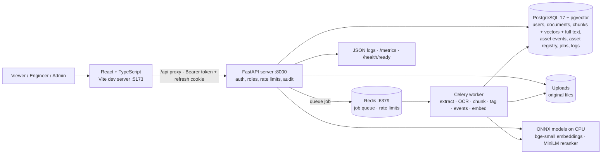
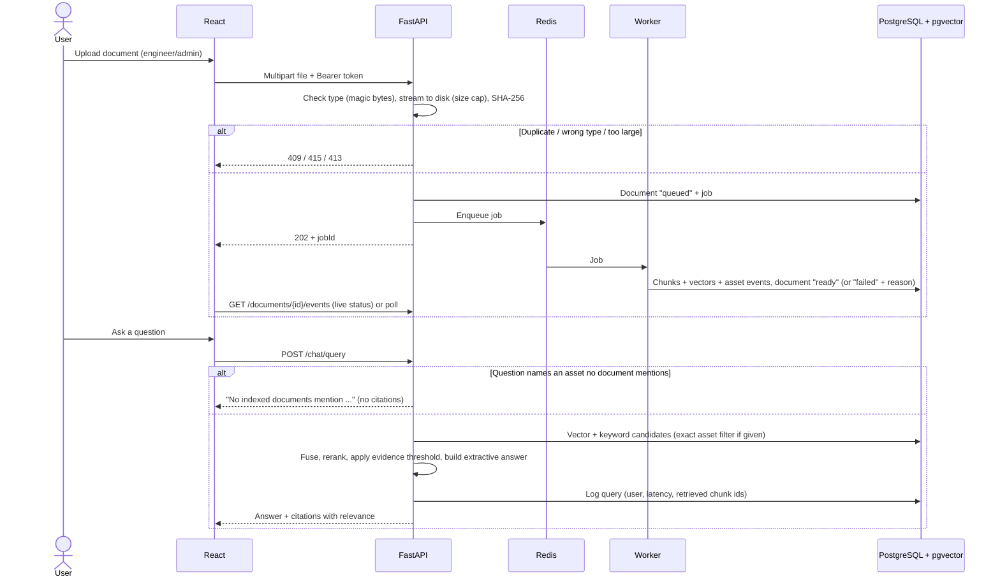

# Architecture (current: after Phase 2)

The target production architecture is in [upgrade-plan.md](upgrade-plan.md) §3.

## Components

## Responsibility boundaries

- **React** presents the workflows and talks only to the API, through the hidden `/api` alias until the Phase 4 rebuild moves to `/api/v1`.
- **FastAPI** handles:
  - authentication, roles, rate limits and the audit log
  - accepting uploads: type check, size cap, de-duplication, then queueing
  - retrieval, answers, Asset 360, RCA and analytics
- **The worker** does the CPU-heavy ingestion:
  - text extraction, with OCR for scanned PDFs and images
  - structure-aware chunking: every dated log entry becomes its own chunk
  - per-chunk entities: equipment tags, ISO dates, measurements, failures and actions, with negations ignored
  - asset events from record documents
  - embeddings
- **Inline mode:** without Redis, the API does this work itself.
- **PostgreSQL** is the single store for relational data **and** the search index. Chunks, events and jobs are deleted with their document (`ON DELETE CASCADE`). Schema changes go through Alembic migrations, and the tests fail if the models and migrations differ.
- **No language model is called yet.** Answers are assembled from retrieved evidence (`mode: "extractive"`); Phase 3 adds Qwen3-4B.

## Retrieval

1. **Vector search:** the question's bge-small embedding against chunk embeddings (HNSW, cosine); top 30.
2. **Keyword search:** Postgres full text (`websearch_to_tsquery`, words OR-ed, ranked by `ts_rank_cd`); top 30.
3. **Fusion:** reciprocal rank fusion (k = 60) of both lists; the top 20 go on.
4. **Reranking:** the MiniLM cross-encoder scores each (question, passage) pair. The sigmoid of that score is the evidence's relevance, from 0 to 1.
5. **Threshold:** below `MIN_EVIDENCE_SCORE` (0.005), the answer is "insufficient evidence". The threshold is low on purpose, and [eval/README.md](../eval/README.md) explains why.

An asset-tag filter is an exact match on the chunk's subject equipment (GIN index). A question that names an exact uploaded filename is scoped to that file.

## Request and data flow

Access tokens expire after 15 minutes. The UI then calls `POST /auth/refresh` with the httpOnly cookie, which rotates, and retries the request.
