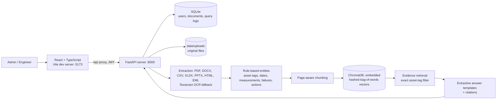

# IndusMind AI System Architecture (current)

This is what runs today. The target production architecture is in [../UPGRADE_PLAN.md](../UPGRADE_PLAN.md) §3.

## Responsibility boundaries

- React presents the workflows and talks only to the FastAPI server.
- FastAPI handles authentication (JWT), document storage, extraction, indexing, retrieval, answers, Asset 360, RCA and analytics.
- SQLite stores users, document metadata and query logs.
- ChromaDB runs embedded and persistent under `data/chroma`.
- No language model is called yet. Answers are assembled from retrieved evidence (`mode: "extractive"`).
