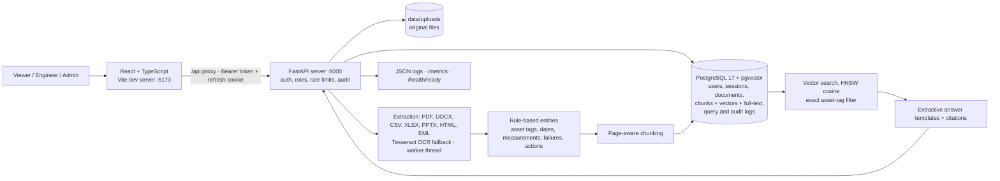

# IndusMind AI System Architecture (current: after Phase 1)

The target production architecture is in [../UPGRADE_PLAN.md](../UPGRADE_PLAN.md) §3.

## Responsibility boundaries

- React presents the workflows and talks only to the API, through the hidden `/api` alias until the Phase 4 rebuild moves to `/api/v1`.
- FastAPI handles:
  - authentication: short-lived JWT access tokens, rotating httpOnly refresh cookies, lockout
  - role checks and rate limits
  - document storage, extraction, indexing, retrieval and answers
  - Asset 360, RCA and analytics
- PostgreSQL is the single store for relational data **and** the search index. Chunks are deleted with their document (`ON DELETE CASCADE`), so they can't drift apart.
- Schema changes go through Alembic migrations. The test suite fails if the models and migrations differ.
- No language model is called yet. Answers are assembled from retrieved evidence (`mode: "extractive"`).
